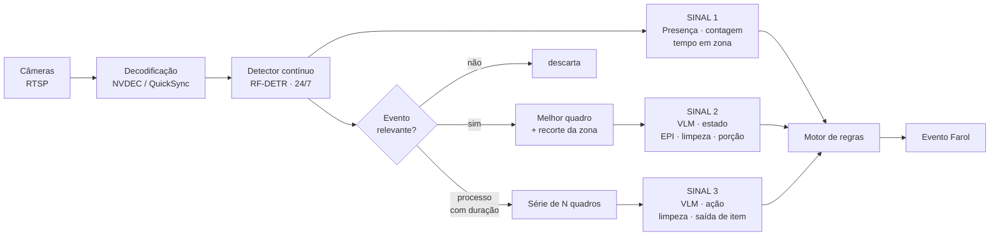
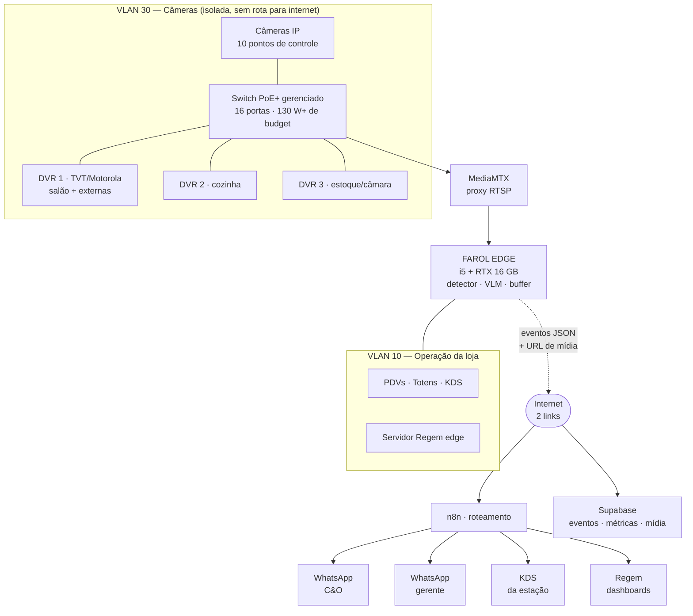
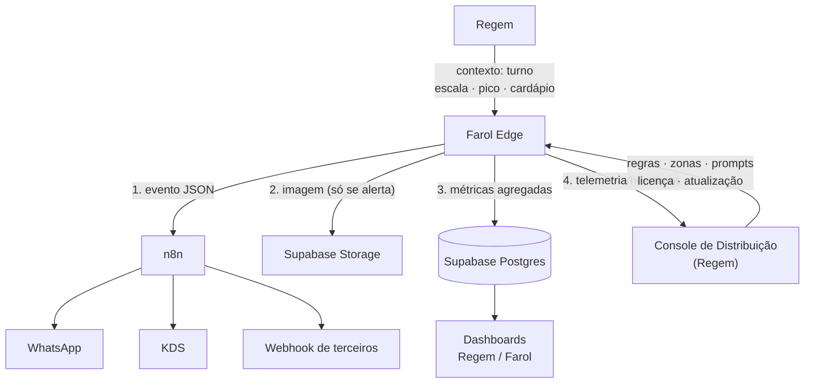
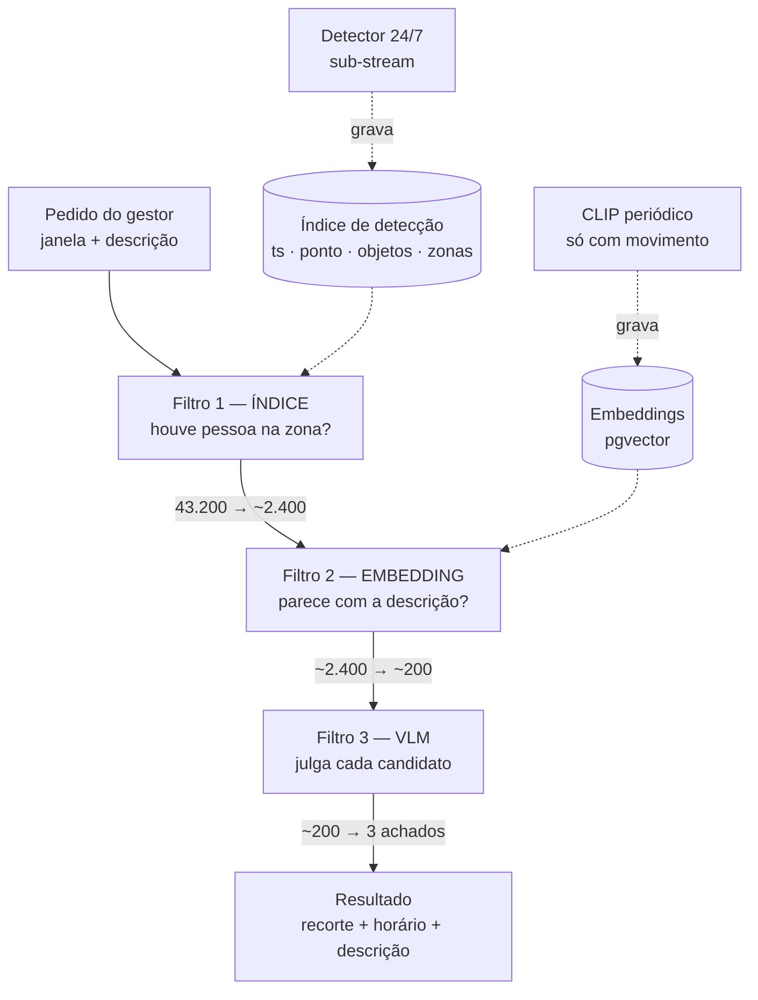

# FAROL — Mapeamento, Arquitetura e Orçamento

**Plataforma de auditoria operacional por visão computacional**
Cliente-âncora: Mister Burguer Steakhouse LTDA · Visão de produto: multi-ramo, revendável
Documento mestre · v2 · 11/08/2026 · *supersede o `ARQUITETURA-E-ROADMAP.md` v1 (18/07/2026)*

---

## Sumário executivo

O Farol já tem um núcleo funcional: captura RTSP do DVR, julgamento por IA e emissão de evento para o n8n. O que falta não é código novo — é **corrigir três decisões de engenharia** que estão limitando o resultado, e **construir a camada de produto** (console de configuração, catálogo de regras, telemetria, licenciamento) que transforma o script em algo revendável.

**Os três achados que precedem qualquer compra de equipamento:**

| # | Achado | Impacto | Custo de corrigir |
|---|---|---|---|
| 1 | O sistema analisa o **sub-stream** do DVR — medi as imagens de teste: canal 5 está em **352×240** e canal 11 em **704×480** | É a causa direta de 100% dos `indeterminado` no histórico. A IA não erra: ela não consegue ver | **Uma linha no `config.yaml`** |
| 2 | O motor roda **por relógio**, não por evento — analisa a cozinha vazia a cada 5 min | 2 dos 6 vereditos registrados foram "área vazia". Desperdício de token e de sinal | 1 dia de trabalho |
| 3 | **Uma chamada de IA por verificação**, sobre o mesmo frame | Multiplica o custo por N verificações do setor sem ganho | 2 horas |

**A conclusão que importa para o orçamento:** não dá para especificar câmeras enquanto o sistema estiver olhando 352×240. O upgrade de câmera pode ser desnecessário em metade das zonas — ou insuficiente nas outras — e só o teste com main-stream revela quais. **A Fase 1 é gratuita e define o orçamento das Fases seguintes.**

### Decisões tomadas (11/08/2026)

| Decisão | Escolha | Consequência principal |
|---|---|---|
| **Parque de câmeras** | **Analógicas** (HDCVI/AHD/TVI, coaxial) | Toda captura passa obrigatoriamente pelo DVR. MediaMTX deixa de ser boa prática e vira **obrigatório**. O teto de resolução é do DVR, não da câmera — ver §7 |
| **Posição do produto** | **Separado do Regem, com integração diferenciada** | Repo, console e licença próprios; contrato bidirecional de primeira classe com o Regem, no mesmo molde já usado com o GoGeM — ver §10 |
| **Rede** | **Unificar os 3 switches** numa rede só, com duas internets divididas | Unificar está certo — mas **com VLAN, não rede plana**, senão destrói o isolamento que hoje existe por acidente. E dividir internet por faixa de DHCP **não funciona sozinho**: o que decide a saída é o gateway, não o IP — ver §3.1 (b) e (c) |
| **DVR** | **Trocar por modelo superior** — todos são Motorola/TVT | Indicado: **Intelbras MHDX 3116**. Mas trocar **um** (o da cozinha), não três, e medir antes de decidir os outros — ver §8.5 |
| **Investimento** | **Até R$ 10 mil** | Cabe o essencial, mas **não** cabe tudo de uma vez. A alocação recomendada difere da compra direta do Cenário A — ver §16 |
| **Gravação** | **O DVR já grava 30 dias**, com sobrescrita cíclica; as câmeras seguem cumprindo a função de segurança | O Farol **não grava vídeo** — lê o que já existe e guarda só o recorte de alerta. Habilita a **Investigação**: busca retroativa por linguagem natural sobre o gravado — ver §14 |

---

## 1. Diagnóstico do que já existe

### 1.1 Inventário

| Item | Estado | Observação |
|---|---|---|
| `monitor_loja.py` | Funcional | Motor de captura → IA → evento. Boa separação de responsabilidades |
| `config.yaml` | Funcional | 5 setores, 8 verificações. Segredo em texto plano (ver 1.3) |
| `teste_camera.py` | Funcional | Ferramenta de calibração manual — vira função do console |
| `testa_webhook.py` | Funcional | Valida o n8n isoladamente. Bem feito |
| `historico.jsonl` | 6 registros | Amostra pequena, mas reveladora |
| Contrato de evento | v2.0 | Base sólida; precisa evoluir (ver §9) |
| Webhook n8n | **Não conectado** | `webhook_url: "COLE_AQUI..."` |
| DVR | Mapeado | Motorola MTD161L0013 (firmware TVT), RTSP `chID={canal}&streamType=` |

### 1.2 O que o histórico prova

Seis vereditos, **todos `indeterminado`**. Lendo as observações:

> *"o ângulo da câmera e a **resolução limitada** não permitem avaliar com confiança"*
> *"a **resolução** da câmera não permite visualizar claramente o interior dos cestos"*
> *"Nenhuma pessoa visível na área da chapa"* (×2)

Quatro dos seis são falha de **resolução**. Dois são **cena vazia** — o motor gastou uma chamada de IA para descobrir que não havia ninguém para auditar.

### 1.3 Achados técnicos do código

**Bloqueantes:**

1. **Sub-stream em vez de main-stream.** `url_rtsp_template` termina em `streamType=sub`. Confirmado nas imagens: 352×240 e 704×480. O DVR quase certamente entrega 1080p ou mais no `streamType=main`. Sub-stream é a escolha certa para *detecção contínua de movimento*; é a escolha errada para *o frame que vai à IA*.

2. **Frame obsoleto na captura.** `cap.read()` logo após abrir o RTSP costuma devolver um quadro do buffer inicial — frequentemente um I-frame parcial, com artefatos. O correto é descartar alguns quadros antes de capturar:
   ```python
   for _ in range(5):
       cap.grab()
   ok, frame = cap.retrieve()
   ```

3. **Janela de horário quebra à meia-noite.** `dentro_da_janela("23:00-01:00")` retorna sempre `False`, porque `dtime(23,0) <= agora <= dtime(1,0)` é impossível. Por isso o config usa `"23:00-23:59"` como contorno. Corrigir: se `fim < inicio`, testar `agora >= inicio or agora <= fim`.

4. **Sem cooldown nem deduplicação.** Chapa suja às 15:00 gera alerta a cada 5 minutos, indefinidamente. **Isto mata a credibilidade do sistema em um único dia** — o gerente silencia o grupo e o projeto morre. Precisa de: janela de silêncio por `(setor, verificação)` e reabertura só quando o estado muda.

**Importantes:**

5. **N chamadas de IA por frame.** O loop `for verif in pendentes` faz uma requisição por verificação sobre a *mesma* imagem. Enviar todas as verificações do setor num único prompt, pedindo um array de resultados, reduz o custo em ~60% e melhora a coerência (a IA vê o conjunto).

6. **Só a não-conformidade é emitida.** `deve_emitir()` filtra `nao_conforme`. Sem o denominador (as conformidades), não existe *taxa* de conformidade — e a métrica é o produto. As conformidades precisam ser persistidas, mesmo que não alertem.

7. **Segredo em texto plano.** `senha: r2d23cpo` no `config.yaml`. Aceitável num protótipo local; inaceitável num produto instalado em loja de cliente. Separar config (versionável) de segredo (`.env`, DPAPI no Windows, ACL no diretório).

8. **Fuso inconsistente.** `datetime.now()` (ingênuo) no histórico contra `.astimezone()` no evento. Em produto multi-loja isso vira bug de relatório.

9. **`snapshot_base64` embutido no webhook.** Uma imagem de 1024px em base64 tem ~200 KB e infla o payload em 33%. O n8n sofre com isso em volume. Correto: subir a imagem no storage e enviar a **URL** no evento.

---

## 2. O que o Farol é — definição de produto

O Farol **não é** um NVR com IA. NVR responde *"entrou alguém?"*. O Farol responde *"o processo foi executado conforme o padrão?"*.

Isso muda a arquitetura de forma decisiva. Olhando a lista de regras pretendidas, elas **não são todas do mesmo tipo** — e tratá-las como se fossem é o erro que encarece o sistema em 10×:

| Regra pretendida | Tipo de sinal | Precisa de IA de visão cara? |
|---|---|---|
| Uso de uniforme / EPI | Estado, 1 quadro | **Sim** — VLM |
| Comportamento inadequado | Estado, 1 quadro | **Sim** — VLM |
| Arrumação / organização padrão | Estado, 1 quadro | **Sim** — VLM |
| Porção / nível de produto | Estado, 1 quadro | **Sim** — VLM |
| Método de limpeza correto | **Sequência** de quadros | **Sim** — VLM sobre série |
| Saída de item da câmara fria | **Sequência** + zona | **Sim** — VLM sobre série |
| Procedimento padrão executado | **Sequência** | **Sim** — VLM sobre série |
| Horário de chegada ao setor | **Presença em zona + relógio** | **Não** — detector basta |
| Tempo fora do setor | **Presença em zona + duração** | **Não** — detector basta |
| Pico de demanda / fila | **Contagem ao longo do tempo** | **Não** — detector basta |

**Um terço das regras não precisa de VLM.** Precisa de um detector de objetos barato somado a lógica de zona e tempo. Essa separação é a diferença entre um sistema que custa R$ 300/mês de nuvem e um que custa R$ 3.000.

### As três fontes de sinal do Farol



| Sinal | Frequência | Custo unitário | Alimenta |
|---|---|---|---|
| **1 — Detector contínuo** | 5 fps × 10 câmeras, 24/7 | ~zero (Coral ou GPU) | Ocupação, pico, horário de chegada, tempo fora do setor, gatilho dos outros dois |
| **2 — VLM sobre estado** | ~500/dia | 1 imagem | EPI, limpeza, porção, organização, comportamento |
| **3 — VLM sobre ação** | ~30/dia | 6 a 10 imagens | Método de limpeza, saída da câmara, procedimento |

O motor atual implementa apenas o Sinal 2, disparado por relógio. **A evolução central do Farol é introduzir o Sinal 1 como gatilho** — isso corrige simultaneamente o desperdício, a latência e habilita um terço das regras que hoje não têm como existir.

E há um quarto uso dos mesmos três sinais, aplicado ao **passado** em vez do presente: a **Investigação** — busca por linguagem natural sobre os 30 dias que o DVR já tem gravados. Detalhada em §14, porque depende do índice que o Sinal 1 produz.

---

## 3. Arquitetura alvo

### 3.1 Topologia física na loja



**Três decisões de topologia:**

**(a) MediaMTX entre o DVR e o Farol — obrigatório, não opcional.** Com parque analógico, *toda* captura passa pelo DVR: não existe falar direto com a câmera. DVRs TVT limitam conexões RTSP simultâneas (tipicamente 4 a 8, com teto de banda de saída agregada). Com 10 pontos e dois consumidores por canal (detector contínuo + captura de alta para o VLM), o limite estoura com certeza. O [MediaMTX](https://github.com/bluenviron/mediamtx) puxa **uma** conexão por canal e reexporta para N consumidores. Custo: zero. É a peça que evita descobrir o problema depois de comprar o hardware.

**(a.2) Câmeras IP em paralelo, sem passar pelo DVR.** Onde o analógico não entregar (§7), a câmera IP nova entra ligada no switch e fala **direto** com o Farol por ONVIF/RTSP — não no DVR. Isso permite upgrade ponto a ponto sem trocar DVR nem cabeamento coaxial existente, e é o único caminho para cor 24 h.

**(b) Unificar as três redes — com VLAN, não com rede plana.** A decisão de interligar os 3 switches está **correta e é necessária**: o Farol precisa alcançar os 3 DVRs de um ponto só. Mas o *como* importa muito.

> ⚠️ **Hoje os DVRs estão isolados por acidente** — três redes fisicamente separadas é isolamento de verdade. Interligar os switches numa **rede plana** destrói essa proteção: os DVRs passam a conversar com o Wi-Fi de clientes e a enxergar a internet. Interligar com **VLAN** entrega o mesmo objetivo e preserva o isolamento.

Plano de segmentação:

| VLAN | Uso | Internet |
|---|---|---|
| 10 | Operação: PDVs, totens, KDS, servidor Regem, **Farol Edge** | Link 1 (interno) |
| 20 | Wi-Fi de clientes | Link 2 (compartilhado) |
| **30** | **CFTV: DVRs e câmeras** | ⭐ **Nenhuma** |
| 99 | Gerência: switches, roteador | Restrita |

O Farol Edge fica na VLAN 10 com uma perna na VLAN 30 (porta *trunk* ou segunda interface), sendo o **único** dispositivo autorizado a falar com os DVRs. Regra de firewall:

```
VLAN30 → INTERNET        DROP
VLAN30 → VLAN10, VLAN20  DROP
VLAN10 (só o Farol) → VLAN30:554  ALLOW
```

**Consequência prática boa:** com VLAN, os dois adaptadores USB de rede saem do orçamento — o Farol alcança os três DVRs por uma única interface.

**(c) Separar as duas internets: o DHCP sozinho não faz isso.** Distribuir duas faixas de IP no mesmo servidor DHCP **não** separa as internets. O que decide por onde o tráfego sai é o **gateway padrão** que cada cliente recebe, não o número do IP. Três caminhos:

| Caminho | Como funciona | Avaliação |
|---|---|---|
| Dois escopos DHCP com **gateways diferentes** | Faixa A recebe gateway do link 1; faixa B, do link 2 | Funciona, mas **sem isolamento**: qualquer pessoa fixa o IP e escolhe a internet. Tráfego entre faixas segue livre (mesma L2) |
| **VLAN + roteamento por origem** (PBR) | Cada VLAN é rede separada; o roteador decide a saída pela origem | ⭐ **O correto.** Isolamento real, controle real. Exige roteador com PBR |
| Dois roteadores independentes | Cada rede num roteador | Simples, mas dobra equipamento e complica o acesso do Farol aos DVRs |

**Recomendação: VLAN + PBR num MikroTik.** Um `hEX S` (~R$ 500) ou `RB5009` (~R$ 1.500) faz VLAN 802.1Q, dois links WAN com roteamento por origem, *failover* automático e firewall entre VLANs. É o equipamento que integrador brasileiro usa para exatamente isso, e custa uma fração de um UDM.

Para o Farol especificamente, **failover é melhor que link dedicado**: o volume de saída é de ~150 MB/dia (irrisório), e o que importa é nunca ficar sem rota. O buffer `eventos_pendentes.jsonl` já cobre a queda; o failover evita usá-lo.

**(d) ⚠️ Renumerar os DVRs ANTES de interligar os switches.** Se os 3 DVRs estão hoje em redes separadas, é muito provável que dois ou três tenham **o mesmo IP** — o padrão de fábrica. No instante em que os switches se encontrarem numa rede plana, dá conflito e algum DVR sai do ar. Endereçamento sugerido, tudo em **IP fixo**:

```
VLAN 30 — 192.168.30.0/24
  192.168.30.10   Farol Edge (perna na VLAN de CFTV)
  192.168.30.11   DVR 1
  192.168.30.12   DVR 2
  192.168.30.13   DVR 3
  192.168.30.50+  câmeras IP
```

**DVR e câmera nunca em DHCP.** Endereço que muda quebra a captura em silêncio — o motor apenas passa a devolver `falha_captura` e ninguém entende por quê.

**(e) Os switches atuais podem ser aproveitados.** Não é preciso trocar os três por gerenciados. Basta **um switch gerenciado central** com VLAN 802.1Q; cada switch atual (mesmo não gerenciado) é ligado numa **porta de acesso** dele, ficando inteiro dentro da VLAN 30. Economia direta de ~R$ 800.

### 3.2 Fluxo de dados e integração



O Farol é **bidirecional**: sobe evento e telemetria, desce configuração e contexto. Isso é o que permite operar 50 lojas sem entrar em nenhuma delas.

---

## 4. Catálogo de regras — modelo de dados

O `config.yaml` atual é `setor → verificações[]`. Para virar produto precisa de mais um nível e de identificadores estáveis.

```
ESTABELECIMENTO
 └── SETOR            (área operacional: "Cozinha")
      └── PONTO       (uma câmera: canal 5 do DVR 2, nome "Chapa")
           └── ZONA   (polígono dentro do quadro: "superfície da chapa")
                └── REGRA
                     ├── id estável (não muda quando o nome muda)
                     ├── tipo: estado | acao | presenca | contagem
                     ├── sinal: detector | vlm_quadro | vlm_serie
                     ├── prompt (versionado)
                     ├── ativacao: janela · dias · contexto (pico, turno)
                     ├── severidade: info | atencao | critico | emergencia
                     ├── confianca_minima
                     ├── cooldown_minutos
                     ├── acao: [kds, whatsapp_gerente, whatsapp_co, registro]
                     └── retencao_midia_dias
```

**Por que `ZONA` separada de `PONTO`:** uma câmera enquadra a chapa *e* a bancada. Recortar a zona antes de enviar à IA é o que permite usar câmera 4 MP com detalhe real sem estourar tokens — o VLM redimensiona a imagem para ~1024–1568 px no lado maior, então mandar 4K inteiro joga fora exatamente o detalhe que você pagou para ter. **Recorte da zona é a técnica que faz câmera boa valer a pena.**

### Severidade e destino

| Severidade | Exemplo | Destino | Retenção da imagem |
|---|---|---|---|
| `emergencia` | Movimento na câmara fria fora do turno; fogo/fumaça | WhatsApp C&O + gerente, imediato | 365 dias |
| `critico` | Manipulação de alimento sem luva; saída de item não registrada | WhatsApp gerente + KDS | 180 dias |
| `atencao` | Chapa suja no fechamento; excesso de porção | KDS + registro | 90 dias |
| `info` | Conformidade registrada; contagem de fila | Só registro/métrica | Sem imagem |

**Regra de armazenamento (confirmando a diretriz do projeto):** imagem só existe quando há alerta. Conformidade vira **linha de métrica**, nunca imagem. Ver o cálculo em §8.3 — é o que mantém o custo de storage irrisório.

---

## 5. A peça que falta: o conjunto de avaliação

Esta é a recomendação mais importante do documento, e é a que normalmente ninguém faz.

Hoje, escolher entre Qwen3-VL 8B e 32B, entre sub e main-stream, entre câmera atual e câmera nova, entre prompt A e prompt B, é **fé**. Não há como saber se mudou para melhor.

**Construa um conjunto rotulado antes de mais nada:**

1. Capture **200 quadros reais** das câmeras do Mister Burguer — cobrindo dia e noite, movimento e parado, cozinha cheia e vazia, contraluz, vapor.
2. Para cada quadro, registre o **veredito humano correto** em cada regra aplicável (`conforme` / `não conforme` / `não avaliável`).
3. Guarde como um arquivo versionado no projeto.

A partir disso você mede, com número:

| O que a régua responde | Sem o conjunto | Com o conjunto |
|---|---|---|
| Main-stream melhora quanto? | "parece melhor" | "acurácia 61% → 88%" |
| 8B basta ou preciso de 32B? | palpite | "84% vs 91% — não compensa a placa" |
| Vale trocar a câmera da chapa? | palpite caro | "89% do teto; troca não resolve, o ângulo resolve" |
| O prompt novo melhorou? | achismo | mede antes e depois |
| Modelo local x nuvem | fé | comparação direta |

**Custo: um dia de trabalho.** Retorno: todas as decisões de compra deste documento passam a ser decididas por medição, não por opinião. Sem isso, o orçamento inteiro é chute — inclusive o meu.

---

## 6. Escolha do modelo — "quantos bilhões"

Resposta direta à pergunta, com o critério e não só o número:

| Faixa | Modelos | VRAM (Int4/FP8) | O que faz bem | O que **não** faz |
|---|---|---|---|---|
| **2–4 B** | Qwen3-VL 2B/4B, Moondream 3, MiniCPM-V | 2–5 GB | Triagem: "tem pessoa?", "a zona está ocupada?" | Julgar EPI, contar itens, avaliar limpeza |
| **7–8 B** ⭐ | **Qwen3-VL 8B**, MiniCPM-V 8B | 6–9 GB | **Piso para julgamento de conformidade.** EPI, estado de superfície, organização, leitura de texto na cena | Cena muito confusa, contagem precisa acima de ~8 itens |
| **12 B** | Gemma 3 12B, Pixtral 12B | 9–14 GB | Redação de relatório, português forte | Localização precisa de objeto |
| **27–32 B** ⭐⭐ | **Qwen3-VL 32B**, Gemma 3 27B, InternVL3 38B | 18–34 GB | **Alvo de produção.** Contraluz, vapor, cena cheia, contagem, ação em série | — |
| **70 B+** | Qwen3-VL 235B, InternVL3 78B | 45 GB+ | Ganho marginal | Não justifica a infra neste caso de uso |

**Recomendação fundamentada:**

- **Desenvolver e calibrar com Qwen3-VL 8B** (FP8) — cabe em 12 GB, responde em 2–4 s, licença Apache 2.0 (essencial para revenda).
- **Homologar contra Qwen3-VL 32B** (AWQ Int4) usando o conjunto de avaliação da §5. Se o ganho for menor que ~5 pontos de acurácia, fique no 8B e economize a placa.
- **Moondream 3 como triagem** nas regras de alta frequência ("tem alguém na zona?") — 300 ms, praticamente de graça.

**Licença é requisito, não detalhe:** o Farol vai ser revendido. Isso elimina de saída Ultralytics YOLO (AGPL-3.0 — obriga a abrir o código de todo produto que atende por rede), YOLO-NAS e os pesos não-comerciais do InsightFace. Use **Qwen3-VL (Apache 2.0)** e **RF-DETR / RT-DETR / D-FINE (Apache 2.0)**.

---

## 7. Câmeras — o plano para parque analógico

O parque é **analógico** (HDCVI/AHD/TVI sobre coaxial). Isso muda a estratégia por completo: o caminho óbvio — trocar tudo por IP — custa R$ 15–20 mil só em instalação e está fora do orçamento. Existem quatro caminhos mais baratos antes dele.

### 7.1 O que limita a imagem hoje

Em CFTV analógico, o teto de qualidade é o **menor** entre três coisas: o padrão do cabo, a câmera e **o que o DVR aceita gravar**. Na prática, quase sempre o DVR é o teto.

| Padrão | Resolução máxima usual | Cabo | Alcance |
|---|---|---|---|
| CVBS (analógico tradicional) | 960H (960×576) | RG59 | ~300 m |
| **AHD** | 1080p · 5 MP · 8 MP | RG59 | ~500 m |
| **HDCVI** (Dahua) | 1080p · 4 K | RG59 | ~800 m |
| **TVI** (Hikvision) | 1080p · 5 MP · 8 MP | RG59 | ~500 m |

> ⚠️ **A armadilha do "1080N".** DVRs de linha econômica anunciam 1080p mas gravam em **1080N = 960×1080** — metade da resolução horizontal, esticada na exibição. Se o Motorola MTD161L0013 for 1080N, esse é o teto real de *todos* os canais e **nenhuma câmera nova resolve**. Verificar em *Menu → Gravação/Encode → Resolução*. A Fase 1 mede isso de qualquer forma, ao capturar o main-stream.

### 7.2 Os quatro caminhos, do mais barato ao mais caro

| # | Caminho | Custo/ponto | O que ganha | Limite |
|---|---|---:|---|---|
| **1** | **Main-stream em vez de sub-stream** | **R$ 0** | 352×240 → o que o DVR gravar (720p/1080p). Ganho de 4× a 25× em pixels | Teto do DVR |
| **2** | **Reposicionar a câmera existente** | R$ 150–300 | ⭐ **Ângulo certo.** Em várias zonas vale mais que resolução — ver 7.3 | Resolução continua |
| **3** | **Trocar só a câmera analógica** (mesmo coaxial) | R$ 300–600 | Sensor melhor, WDR, lente varifocal, até 5 MP. Reaproveita 100% do cabeamento | Teto do DVR |
| **4** | **Trocar o DVR** por um 5 MP/4 K | R$ 1.200–2.500 (16 ch) | Sobe o teto de **todos** os canais de uma vez. Melhor custo por canal da lista | Continua analógico; sem cor 24 h de qualidade |
| **5** | **Câmera IP dedicada em paralelo** | R$ 1.500–2.000 instalado | ⭐ Cor 24 h real, 4 MP, ONVIF, sem passar pelo DVR, sem limite de conexão | Exige lance novo de Cat6 até o ponto |

**A leitura correta desta tabela:** se o DVR for o teto, trocar 10 câmeras (R$ 3.000–6.000) não resolve nada — enquanto trocar o DVR (R$ 2.000) melhora os 16 canais. E se a regra exige **cor à noite** ou **ângulo que o coaxial não alcança**, só o caminho 5 resolve, e aí vale para 2 ou 3 pontos, não para dez.

### 7.3 Ângulo vence resolução

Vale repetir com o caso concreto: a regra *"excesso de batata no cesto"* precisa ver **dentro** do cesto. O histórico mostra a IA respondendo *"a fritadeira aparece ao fundo à direita, mas o ângulo não permite visualizar o conteúdo do cesto"*. Nenhuma resolução corrige isso — 8 MP apontados para o corredor continuam não mostrando o interior do cesto. **Uma câmera de 2 MP posicionada acima e à frente resolve; uma de 8 MP no lugar errado, não.**

Por isso o caminho 2 (reposicionar) vem antes de qualquer compra: é barato, rápido, e em várias zonas é a solução inteira.

### 7.4 Estratégia recomendada — híbrida

| Zona | Caminho | Custo estimado |
|---|---|---:|
| Chapa / Grelha | Main-stream + **reposicionar** (ver a superfície, não o corredor) | R$ 300 |
| Fritadeira / Batata | **Câmera IP dedicada**, acima e à frente do cesto | R$ 1.800 |
| Bancada de Montagem | Main-stream (o canal 11 já tem enquadramento bom) | R$ 0 |
| Balcão / Fila | Main-stream (contagem funciona em resolução modesta) | R$ 0 |
| Estoque / Câmara fria | Main-stream + reposicionar se necessário | R$ 0–300 |
| Demais pontos | Main-stream | R$ 0 |

Se a Fase 2 provar que o DVR é o gargalo em vários canais ao mesmo tempo, **trocar o DVR passa à frente de qualquer câmera** — é o único investimento que melhora tudo de uma vez.

### 7.5 Especificação para as câmeras IP dedicadas

Quando o caminho 5 for a escolha (previsto para 1 ou 2 pontos):

| Critério | Especificação | Por quê, neste projeto |
|---|---|---|
| **Resolução** | **4 MP (2560×1440)** padrão; 8 MP só onde precisa de detalhe fino | O VLM redimensiona para ~1568 px. 4 MP + recorte de zona entrega mais detalhe útil que 4K inteiro |
| **Lente** | **Varifocal motorizada 2,8–12 mm** | Cozinha é apertada e o enquadramento certo só se descobre testando. Motorizada = ajusta pelo navegador, sem escada |
| **WDR** | **≥ 120 dB real** | Cozinha tem porta/janela ao fundo. Sem WDR, a pessoa vira silhueta preta e nenhuma IA julga EPI |
| **Baixa luz** | Sensor **1/1.8"** · **luz branca (ColorVu / Full-color)** | ⭐ **Se cair para infravermelho preto-e-branco, você perde a cor — e cor é o dado.** Touca branca, luva azul, carne crua × selada, resíduo. IR mata metade das regras |
| **Codec** | H.265 + **sub-stream configurável** | Sub para o detector 24/7, main para o quadro que vai à IA |
| **Padrão** | **ONVIF Profile S** + RTSP | Não ficar refém de fabricante no produto revendido |
| **Proteção** | IP66, formato **bullet** | Domo com bolha embaça e engordura em cozinha; bullet limpa fácil |
| **Alimentação** | **PoE (802.3af/at)** | Um cabo por ponto |

### 7.6 Modelos de referência (mercado BR)

**Câmeras IP** — para o caminho 5, nos pontos críticos:

| Modelo | Faixa | Perfil |
|---|---|---|
| **Hikvision DS-2CD2T47G2-L** (ColorVu 4 MP) | R$ 1.100–1.400 | ⭐ Cor 24 h. A escolha para a fritadeira e para qualquer zona com regra de EPI noturna |
| **Dahua IPC-HFW3441T-ZAS** (4 MP WizSense, varifocal motorizada) | R$ 900–1.200 | ⭐ Melhor equilíbrio; varifocal motorizada evita voltar com a escada |
| **Intelbras VIP 3240 B Z** (4 MP varifocal) | R$ 900–1.100 | Suporte e reposição nacionais — vale muito no produto revendido |
| **Uniview IPC2124** | R$ 600–800 | Custo-benefício; suporte mais fraco |

**Câmeras analógicas** — para o caminho 3, reaproveitando o coaxial. Confirme antes qual padrão o DVR aceita (HDCVI, AHD ou TVI) e qual resolução máxima:

| Modelo | Faixa | Perfil |
|---|---|---|
| **Intelbras VHD 3240 Z** (multi-HD 4 MP, varifocal) | R$ 450–650 | ⭐ Multi-HD aceita HDCVI/AHD/TVI/CVBS — não erra o padrão |
| **Intelbras VHD 1230 B G7** (multi-HD 2 MP) | R$ 250–350 | Substituição simples onde 1080p basta |
| **Dahua HAC-HFW1500** (HDCVI 5 MP) | R$ 400–550 | Só se o DVR aceitar 5 MP |
| **Intelbras VHD 3120 B Full Color** | R$ 400–500 | Cor 24 h no analógico — opção intermediária, qualidade abaixo do ColorVu IP |

> **Multi-HD é a escolha segura.** Câmeras "multi-HD" comutam entre HDCVI, AHD, TVI e CVBS por chave ou menu. Como ainda não confirmamos o padrão do MTD161L0013, comprar multi-HD elimina o risco de levar a câmera errada.

---

## 8. Infraestrutura

### 8.1 Cabeamento

| Item | Especificação | Observação |
|---|---|---|
| Cabo de dados | **Cat6 U/UTP CMX 4 pares 23 AWG, cobre puro** | Recusar CCA (alumínio revestido) — não sustenta PoE e esquenta |
| Distância | Máx. **90 m** por lance + 10 m de patch | Além disso, switch intermediário |
| Proteção | **Eletroduto** em áreas de calor/gordura; canaleta no salão | Cozinha degrada capa comum |
| Conectorização | Keystone Cat6 no patch panel; RJ45 blindado na ponta da câmera | Evitar emenda |
| Aterramento | Rack aterrado; DPS na entrada | Protege contra surto em rede com câmeras externas |

### 8.2 Switch, roteamento e energia

Como o parque é analógico, **PoE não é requisito agora** — as câmeras se alimentam pelo próprio cabeamento coaxial/fonte existente. O PoE só entra quando houver câmera IP, e aí um switch pequeno resolve.

| Item | Especificação | Faixa |
|---|---|---|
| **Switch gerenciado central** | 16 portas Gigabit, **VLAN 802.1Q**, porta *trunk* | R$ 600–900 |
| | *TP-Link TL-SG1218 · Intelbras SG 1600 · Ubiquiti USW-Lite-16* | |
| **Roteador / firewall** | 2 WAN, **PBR (roteamento por origem)**, VLAN, firewall entre VLANs, *failover* | R$ 450–1.500 |
| | ⭐ *MikroTik hEX S (RB760iGS) · MikroTik RB5009 · pfSense em mini PC* | |
| Switch PoE+ (só quando houver câmera IP) | 8 portas PoE+, budget ≥ 65 W | R$ 700–900 |
| Nobreak | 1500 VA senoidal para Farol Edge + switch + roteador; **3000 VA** se os DVRs também entrarem | R$ 1.200 / R$ 2.600 |
| Rack | 12 U com patch panel 24 p, guia de cabos, régua | R$ 1.200–1.800 |

**Aproveitando os 3 switches atuais:** não precisam ser trocados. Ligue cada um numa porta de acesso do switch gerenciado configurada como VLAN 30 — o switch antigo inteiro passa a viver dentro da VLAN de CFTV. Economia de ~R$ 800 e nenhuma perda funcional.

**Quando o PoE entrar, não economize no budget.** Cada câmera IP 4 MP com iluminador consome 5–8 W. Switch de 45 W parece igual na prateleira e derruba câmeras à noite, quando o iluminador liga — falha intermitente e dificílima de diagnosticar.

### 8.3 Armazenamento — dimensionamento real

**Storage do Farol** (só alertas — a diretriz do projeto está correta):

| Item | Cálculo | Volume |
|---|---|---|
| Imagens de alerta | 500 alertas/dia × 300 KB (JPEG recortado, q85) | **150 MB/dia** |
| Séries de ação (v2) | 30/dia × 8 quadros × 200 KB | 48 MB/dia |
| Eventos + métricas (texto) | 5.000 registros/dia × 500 B | 2,5 MB/dia |
| **Total 90 dias** | | **≈ 18 GB** |

Cabe folgado no Supabase pago que já existe. **O armazenamento do Farol é irrisório** — a estratégia de guardar só descrição e alerta está certa e confirmada por número.

**HD do DVR** — ✅ **já resolvido.** A loja já grava contínuo por 30 dias com sobrescrita cíclica, e as câmeras seguem cumprindo a função de segurança patrimonial sem alteração. Não há investimento a fazer aqui.

Duas consequências que importam para o projeto:

1. **O Farol não grava vídeo** — lê o que o DVR já tem e guarda apenas o recorte que virou alerta. É o que mantém o storage do Farol em ~18 GB por 90 dias.
2. **Os 30 dias de gravação são o acervo da Investigação** (§14) — e definem o teto de retenção do índice. Ver a regra de retenção em §14.7.

*Referência, se um dia for preciso redimensionar:* 16 canais em H.265 a 4 Mbps consomem ~20 TB para 30 dias contínuos, ou ~6 TB no esquema "7 dias contínuo + 90 dias por evento". Sempre com disco de vigilância (WD Purple ou Seagate SkyHawk) — disco de desktop não suporta escrita sequencial 24/7 e falha em meses.

### 8.4 PC de análise — Farol Edge

| Componente | Especificação | Motivo | Faixa |
|---|---|---|---|
| CPU | **Intel i5-14400** (ou i5-13400) | ⭐ **Intel de propósito**: o QuickSync da iGPU decodifica os 10 sub-streams de graça e libera a GPU inteira para o VLM | R$ 1.100 |
| Placa-mãe | **B760 LGA1700**, 2 slots PCIe x16 físicos, 2× M.2, 2.5 GbE | Segunda placa no futuro; 2.5 GbE para o storage | R$ 900 |
| RAM | 32 GB DDR5 (2×16) | Sobra | R$ 700 |
| GPU | **RTX 5060 Ti 16 GB** | ⭐ **Nova, com garantia.** Numa loja de cliente, 3090 usada sem garantia é passivo, não economia. FP8 nativo, 180 W | R$ 3.800 |
| Armazenamento | NVMe 1 TB | Sistema + pesos + cache | R$ 450 |
| Fonte | 650 W 80+ Gold | Folga para segunda GPU | R$ 500 |
| Gabinete | Compacto **com filtro de pó** | ⭐ Ar de loja tem gordura e poeira. Filtro + limpeza trimestral é requisito, não capricho | R$ 350 |
| Rede extra | 2× adaptador USB 3.0 Gigabit | Alcançar as 3 redes de DVR sem roteamento | R$ 200 |
| **Total** | | | **≈ R$ 8.000** |

**Compre em dois tempos — a GPU por último.** O gargalo comprovado hoje é **imagem**, não processamento: o motor roda em nuvem e funciona. Comprar R$ 3.800 de GPU antes de resolver o que a câmera enxerga é otimizar a peça errada. A máquina divide-se naturalmente:

| Etapa | Conteúdo | Valor | Quando |
|---|---|---:|---|
| **Farol Edge — base** | i5-14400, B760, 32 GB, NVMe 1 TB, fonte 650 W, gabinete c/ filtro, 2 adaptadores de rede | **R$ 4.200** | Fase 4 — já roda MediaMTX, Frigate e o detector no QuickSync, com o VLM na nuvem |
| **Farol Edge — GPU** | RTX 5060 Ti 16 GB (ou 3090 24 GB) | **R$ 3.800** | Fase 7 ou 9 — quando as séries de quadros entrarem e a conta virar |

A base sozinha entrega as Fases 1 a 6 inteiras. A GPU entra quando houver motivo medido.

**Se for para 32 B:** trocar a GPU por **RTX 3090 24 GB** (R$ 4.500–6.000, usada) ou **RTX 5070 Ti 16 GB**. Para uso próprio no Mister Burguer, a 3090 usada é o melhor custo por VRAM. **Para unidade revendida, sempre placa nova com nota e garantia.**

**Segunda GPU:** só se justifica para separar funções — GPU 0 barata decodificando e rodando o detector, GPU 1 dedicada ao VLM. Não é necessário nesta escala; a placa-mãe já deixa a porta aberta.

---

### 8.5 Troca de DVR — especificação e indicação

Os três DVRs são Motorola (OEM da **TVT**), iguais ao MTD161L0013 já mapeado. Trocar por equipamento superior está aprovado; abaixo o critério e a indicação.

#### O que importa num DVR *para o Farol* (diferente do que importa para segurança)

| Critério | Alvo | Por quê |
|---|---|---|
| **Resolução real de gravação** | 5 MP ou 4 K por canal — **nunca 1080N** | É o teto de qualidade de todos os canais |
| ⭐ **Sub-stream configurável** | Poder definir 704×576 @ 5–10 fps | É a raiz do problema atual: o TVT entrega sub fixo em 352×240. Um sub decente alimenta o detector contínuo sem consumir o canal principal |
| **Banda de saída (*outgoing*)** | ≥ 128 Mbps, idealmente 256 | Define quantos fluxos RTSP simultâneos o Farol consegue puxar |
| **Compatibilidade com o coaxial** | Penta-brid: AHD + HDCVI + TVI + CVBS | Reaproveita todas as câmeras e todo o cabeamento |
| **Canais IP híbridos** | 8 canais IP além dos analógicos | Caminho de transição sem trocar de equipamento |
| **RTSP/ONVIF documentado** | Padrão público e estável | Vira item do catálogo de perfis do Farol (§12) |
| **Codec** | H.265+ | Menos disco, menos banda |
| **Baias SATA** | 2 | Comporta os 6 TB dimensionados em 8.3 |
| **IA embarcada** | SMD Plus / AcuSense | Bônus: separa humano de veículo no próprio DVR e alivia o Sinal 1 |

#### Indicações

| Modelo | Canais | Resolução | Faixa | Perfil |
|---|---|---|---:|---|
| ⭐ **Intelbras MHDX 3116** | 16 analóg. + 8 IP | 5 MP Lite / 4 MP | R$ 1.400–1.900 | **Recomendado.** Suporte e reposição nacionais, RTSP bem documentado, penta-brid, 2 SATA, H.265+ |
| **Intelbras MHDX 5116** | 16 + 8 IP | **4 K real** | R$ 2.500–3.200 | Topo Intelbras. Faz sentido se as câmeras forem migrar para 4 MP/5 MP depois |
| **Dahua XVR5216AN-4KL-I3** | 16 + 8 IP | 4 K | R$ 2.200–2.800 | ⭐ **WizSense/SMD Plus** — IA embarcada separando humano de veículo |
| **Hikvision iDS-7216HQHI-M2/S** | 16 + 8 IP | 4 MP | R$ 2.000–2.600 | AcuSense embarcado; RTSP o mais documentado do mercado |

**Recomendação: Intelbras MHDX 3116.** Três razões, nesta ordem:

1. **Suporte e reposição nacionais.** Num produto que será instalado em lojas de terceiros, ter assistência no Brasil vale mais que dois megapixels a mais. O OEM Motorola/TVT não oferece isso.
2. **RTSP documentado e estável.** O template Intelbras (`/cam/realmonitor?channel=X&subtype=Y`) é o padrão mais comum do país — e vira o **segundo perfil do catálogo de DVRs do Farol**, que é exatamente o ativo que torna a instalação em loja nova uma questão de uma hora.
3. **Sub-stream configurável.** Resolve na origem o problema que hoje custa a análise inteira.

Se a IA embarcada pesar mais que o suporte nacional, o **Dahua XVR com WizSense** é a alternativa — ele entrega parte do Sinal 1 de graça e serve como segunda opinião ao detector.

> **Mas troque um, não três.** Substituir os 3 DVRs custa R$ 4.200–5.700 e consome metade do orçamento — antes de sabermos se o DVR é mesmo o gargalo, o que a Fase 1 mede em dois dias e de graça.
>
> **Comece pelo DVR da cozinha**, onde estão as zonas críticas (chapa, fritadeira, montagem). Por R$ 1.700 você: mede o ganho real no conjunto de avaliação da §5, valida o perfil RTSP Intelbras para o catálogo, e decide os outros dois com número em vez de suposição. Se o ganho for grande, troca os outros com confiança; se for pequeno, economizou R$ 3.400.

## 9. Software e contrato de evento

### 9.1 Pilha

| Camada | Escolha | Licença | Papel |
|---|---|---|---|
| Proxy RTSP | **MediaMTX** | MIT | 1 conexão por canal no DVR, N consumidores |
| Detector / NVR | **Frigate** | MIT | Movimento, detecção, zonas, melhor quadro, gravação por evento |
| Detector de objetos | **RF-DETR** ou **RT-DETR** | Apache 2.0 | Sem contaminação AGPL — requisito de revenda |
| Servidor de modelo | **Ollama** (dev) → **vLLM** (produção) | MIT / Apache 2.0 | Ollama para começar; vLLM quando houver rajada |
| Modelo | **Qwen3-VL 8B FP8** → 32B AWQ | Apache 2.0 | Julgamento |
| Motor Farol | `monitor_loja.py` evoluído | proprietário | Regras, cooldown, contrato, buffer |
| Orquestração | **n8n** (já existe) | Fair-code | Roteamento de alerta |
| Persistência | **Supabase** (já existe) | — | Eventos, métricas, mídia |
| Console | **Módulo do Regem** | proprietário | Ver §10 |

### 9.2 Contrato de evento v3.0

O schema 2.0 é uma boa base. Faltam campos que só doem depois:

```json
{
  "evento_id": "uuid",
  "origem": "farol",
  "versao_schema": "3.0",
  "timestamp": "2026-08-11T15:04:11-03:00",
  "tenant_id": "uuid",
  "loja":  { "id": "loja-01", "nome": "Mister Burguer" },
  "setor": { "id": "set_cozinha", "nome": "Cozinha" },
  "ponto": { "id": "pt_chapa", "nome": "Chapa", "dvr": 2, "canal": 5 },
  "zona":  { "id": "zn_superficie", "nome": "Superfície da chapa" },

  "regra": {
    "id": "rg_epi_chapa",
    "nome": "EPI na chapa",
    "tipo": "estado",
    "sinal": "vlm_quadro",
    "prompt_versao": "v4"
  },

  "resultado": {
    "status": "nao_conforme",
    "confianca": 0.88,
    "observacao": "Pessoa manipulando alimento sem luva; touca presente.",
    "evidencias": ["sem_luva"]
  },

  "severidade": "critico",
  "acao_sugerida": ["whatsapp_gerente", "kds_estacao"],

  "dedupe": {
    "chave": "rg_epi_chapa|pt_chapa|2026-08-11T15",
    "ocorrencia": 1,
    "primeira_em": "2026-08-11T15:04:11-03:00"
  },

  "contexto": {
    "turno": "noite",
    "em_pico": true,
    "escalados_no_setor": 3
  },

  "midia": {
    "url": "https://.../farol/2026/08/11/ev_xxx.jpg",
    "expira_em": "2026-11-09T00:00:00-03:00"
  },

  "custo": { "modelo": "qwen3-vl-8b", "tokens_in": 1180, "tokens_out": 96, "ms": 2840 }
}
```

**O que cada acréscimo resolve:**

- `regra.id` estável — o nome muda, o identificador não. Sem isso a série histórica quebra na primeira renomeação.
- `prompt_versao` — permite comparar acurácia entre versões de prompt. Sem isso, não dá para provar melhora.
- `dedupe` — o antídoto contra a fadiga de alerta.
- `contexto` — o Regem alimenta turno, pico e escala; a regra muda de rigor conforme o contexto.
- `midia.url` em vez de base64 — payload leve, n8n saudável, retenção controlada.
- `custo` — telemetria por evento. Sem medir, não se otimiza; e no modelo de revenda, é a base do preço.

---

## 10. O Farol como produto separado, integrado ao Regem

**Decisão tomada:** produto próprio — repo, console, banco, licença e roadmap independentes — com **integração diferenciada** com o Regem. É a mesma relação já estabelecida com o GoGeM, e o mesmo padrão de documentação deve ser seguido: um `docs/integracao-regem/ENDPOINTS.md` como contrato versionado.

### 10.1 O que isso implica construir

Como produto autônomo, o Farol precisa da sua própria fundação. O que **não** dá para importar do Regem, mas dá para **copiar como padrão** (arquitetura, não código):

| Fundação | Origem do padrão no Regem | Esforço |
|---|---|---|
| Multi-tenant (`tenant_id` em toda query) | Desde o início | Baixo — é disciplina de schema |
| RBAC por perfil | Perfil de acesso editável | Médio |
| Licença: lease assinado + fingerprint + trial | Modelo de distribuição/licença | Médio — o desenho já existe, é reimplementar |
| Telemetria edge → console | Observabilidade | Médio |
| Atualização remota com janela | `publicar.ps1` + agendamento | Baixo |
| Sync nuvem ↔ edge com buffer | Sync espelhado | Alto — mas o Farol precisa menos: só sobe evento |

**Vantagem real da separação:** o Farol pode ser vendido para quem **não** usa o Regem. Como o produto se destina a múltiplos ramos e à revenda, amarrar ao Regem limitaria o mercado ao próprio parque de clientes. Essa é a justificativa que sustenta o custo extra de fundação.

### 10.2 Pilha recomendada

| Camada | Escolha | Por quê |
|---|---|---|
| **Motor de visão** | **Python** | Obrigatório — é onde vivem OpenCV, torch, clientes de vLLM. Já é a base do `monitor_loja.py` |
| **API / console** | **NestJS + Next.js** | Onde você é rápido. O console é CRUD + painel, não ciência de dados. Reaproveita componentes e padrões do Regem sem acoplar |
| **Banco** | **Postgres (Supabase)** | Já contratado |
| **Nuvem** | EasyPanel na VPS | Já existe |
| **Edge** | Docker na loja | MediaMTX + Frigate + motor |

O motor Python lê a configuração da API do console por HTTP e devolve eventos pela mesma via. Fronteira limpa, dois times possíveis, nenhuma linguagem forçada onde não serve.

### 10.3 Contrato de integração com o Regem

**Farol → Regem** (autenticação `X-Sync-Token`, no mesmo molde do GoGeM):

| Endpoint | Conteúdo |
|---|---|
| `POST /api/v1/farol/eventos` | Evento de conformidade (schema v3 da §9) |
| `POST /api/v1/farol/metricas` | Agregados diários por setor/regra, para os painéis |
| `POST /api/v1/farol/heartbeat` | Estado do edge, para o painel de operação |

**Regem → Farol** (o contexto que muda a análise):

| Endpoint | Conteúdo |
|---|---|
| `GET /contexto/turno-atual` | Turno vigente e setores ativos |
| `GET /contexto/janelas-pico` | Janelas de pico cadastradas — ativam ou endurecem regras |
| `GET /contexto/setores` | Espelho dos setores, para mapear ponto → setor do Regem |
| `GET /contexto/escala?setor=&em=` | ⭐ Quem estava escalado naquele setor naquele instante |

### 10.4 A integração que só o Regem tem

Três coisas que justificam chamar a integração de "diferenciada" — nenhum outro sistema receberia:

**1. Responsabilização sem biometria.** ⭐ O Farol **não identifica pessoas** — essa é a decisão que o mantém fora do território de dado biométrico sensível. Mas o Regem sabe **quem estava escalado naquele setor naquele horário**. Cruzando evento + escala, o gestor tem responsabilização sem que o Farol jamais reconheça um rosto. É a solução elegante para o problema que normalmente empurra projetos assim para reconhecimento facial — e o risco jurídico que vem junto.

**2. Não-conformidade vira tarefa corretiva.** Um alerta de "bancada suja" pode abrir automaticamente uma tarefa no módulo de Tarefas do Regem, atribuída ao setor, com foto anexada e prazo. O ciclo fecha dentro do sistema que a equipe já usa — em vez de virar mais uma mensagem em mais um grupo.

**3. Alerta no KDS da estação.** O Regem já tem KDS por setor. O alerta do Farol entra na tela onde a pessoa responsável já está olhando, no momento em que ainda dá para corrigir.

Para qualquer outro sistema, o Farol expõe apenas um **webhook genérico** com o mesmo schema v3 — suficiente para integrar, sem as três acima.

### 10.5 Telas do console Farol a construir

1. **Pontos e zonas** — cadastra DVR/canal, testa RTSP na hora, desenha a zona sobre a imagem ao vivo com o mouse.
2. **Editor de regras** — formulário guiado (o que verificar, o que é conforme, quando, gravidade, ação), com versionamento de prompt.
3. **Teste ao vivo** — o `teste_camera.py` vira botão: captura, analisa, mostra o veredito. É o que permite calibrar sem programador.
4. **Fila de revisão** — os eventos recentes com dois botões: *correto* / *falso positivo*. É a origem do aprendizado (§11).
5. **Painel de conformidade** — taxa por setor/regra/turno, tendência, ranking.
6. **Custo e telemetria** — chamadas por dia, custo por loja, latência, falhas de captura.
7. ⭐ **Investigação** (§14) — escolhe os pontos, a janela (data/hora inicial → data/hora final) e escreve a descrição do que procura. O trabalho roda em segundo plano com progresso e estimativa; o resultado é uma linha do tempo de achados, cada um com recorte, horário e descrição, e um botão para salvar como evento.

---

## 11. Como o sistema aprende

Requisito do projeto: *"o sistema deve aprender com decisões ou análises periódicas."* O caminho realista — e o que **não** fazer:

**Não faça:** ajuste fino (*fine-tuning*) do VLM. Caro, lento, exige milhares de exemplos rotulados, e trava você numa versão de modelo.

**Faça, em três níveis crescentes:**

**Nível 1 — Calibração automática de limiar.** Cada evento revisado como falso positivo entra na conta. Se uma regra passa de 30% de falso positivo em 20 revisões, o sistema sobe automaticamente a `confianca_minima` e avisa no console. Barato, imediato, resolve a maior parte.

**Nível 2 — Exemplos no prompt (*few-shot* visual).** Para cada regra, mantenha 3 a 6 imagens rotuladas *daquela câmera específica*: "isto é conforme", "isto não é". Injete no prompt. **É o que mais melhora acurácia por real investido**, porque ensina o modelo o que significa "limpo" *naquela chapa*, não em uma cozinha genérica. Requer só storage e um bom seletor de exemplos.

**Nível 3 — Classificador leve local.** Depois de ~300 exemplos rotulados por regra, treina-se um classificador pequeno sobre os *embeddings* da imagem (CLIP + regressão logística). Roda em milissegundos, custo zero, e passa a filtrar os casos óbvios antes do VLM. O VLM só decide o que o classificador considera duvidoso. Reduz custo e latência ao mesmo tempo.

O ciclo fecha assim: **evento → revisão do gestor → exemplo rotulado → prompt melhor + limiar melhor + classificador melhor → menos falso positivo → mais confiança → mais revisão.** O conjunto de avaliação da §5 é o que mede se cada volta melhorou de verdade.

---

## 12. Distribuição, licenciamento e telemetria

Herdando o modelo do Regem, com o que é específico do Farol:

**Catálogo de perfis de DVR.** O aprendizado do TVT (URL `chID={canal}&streamType=`, porta 6036, permissão "Remoto" obrigatória sob pena de falha silenciosa) é o primeiro item de uma tabela `fabricante → template RTSP → peculiaridades`. Levantar: Intelbras, Hikvision, Dahua, Giga, Multilaser, OEMs Xiongmai. O instalador escolhe a marca na lista e o sistema monta a URL. **Isso é o que faz a instalação em loja nova durar uma hora em vez de um dia.**

**Pacote de instalação.** Um instalador Windows ou uma imagem Docker que sobe MediaMTX + Frigate + vLLM + motor Farol, lê a licença, registra o *fingerprint* da máquina e puxa a configuração do console. O Regem já tem esse padrão (`publicar.ps1`, envs, janelas de atualização).

**Licença.** Lease assinado com validade, travado por CNPJ + fingerprint, com trial. Modelo já definido no Regem.

**Telemetria obrigatória em produto distribuído:**

| Métrica | Para quê |
|---|---|
| *Heartbeat* por loja | Saber que o Farol está vivo antes do cliente ligar reclamando |
| Falhas de captura por canal | Câmera caiu, DVR mudou de IP, cabo rompeu |
| Latência e custo por evento | Dimensionar preço e detectar degradação |
| Taxa de `indeterminado` por regra | ⭐ Indicador de que a câmera ou o prompt precisa de atenção — o sinal mais útil do sistema |
| Versão do motor e do modelo | Saber o que está rodando em cada loja |
| Erros do motor | Console de distribuição (padrão Regem) |

**Modelo comercial sugerido:** hardware vendido junto (margem, não custo) + mensalidade por ponto de controle ativo. O processamento local torna o custo marginal por loja praticamente zero — que é exatamente o que torna a revenda escalável.

---

## 13. Local × nuvem — a conta honesta

| Cenário | Volume/mês | Nuvem barata (Gemini Flash) | Nuvem premium (Sonnet) | Local |
|---|---|---|---|---|
| Hoje: 1 quadro, 500/dia | 15 mil | ~R$ 30 | ~R$ 330 | R$ 8.000 + R$ 75/mês |
| Com séries (v2): 8 quadros | 15 mil + 900 séries | ~R$ 90 | ~R$ 1.100 | R$ 8.000 + R$ 75/mês |
| Escala: 10 lojas | 150 mil | ~R$ 300 | ~R$ 3.300 | R$ 8.000/loja + energia |

**Sendo direto: para o Mister Burguer hoje, a nuvem é mais barata.** Quinze mil análises de um quadro num modelo econômico custam menos que a energia do PC. Migrar para local agora seria decisão de engenharia, não de economia.

**O que inverte a conta — e vai inverter:**

1. **Análise de sequência (v2).** Multiplica os tokens por 6 a 10. Contra um modelo premium, o retorno do hardware cai para ~5 meses.
2. **Revenda.** Cada loja com nuvem é custo recorrente que come a margem e escala linearmente. Cada loja com hardware é **receita de venda** e custo marginal zero. Este é o argumento decisivo do modelo de negócio.
3. **Privacidade e LGPD.** Imagem de funcionário saindo da loja do cliente é risco jurídico *dele*, transferido para você. Processamento local elimina isso — e vira argumento de venda.
4. **Independência de link.** Auditoria não pode parar porque a internet caiu.

**Decisão recomendada:** continuar em nuvem durante calibração (Fases 1–3), **arquitetando tudo para local desde já** (contrato de evento, abstração de provedor, recorte de zona). Trazer para dentro na Fase 5, quando as séries entrarem — e nascer local em toda loja revendida.

---

## 14. Investigação — busca retroativa no gravado

### 14.1 O que muda

Confirmação importante: **o DVR já grava tudo, 30 dias, com sobrescrita cíclica.** O Farol não grava vídeo e não deve gravar — ele consome o que já existe. Isso valida a arquitetura: as câmeras seguem cumprindo a função de segurança patrimonial sem alteração, e o Farol é um **leitor** que separa o que interessa, alerta e guarda só o necessário.

Isso adiciona um **quarto modo de operação**:

| Modo | Quando | O que faz |
|---|---|---|
| Monitoramento ativo | Durante o turno | Verifica regras, alerta em tempo quase real |
| Vigília | Fora do turno | Monitoramento de exceção |
| Indexação | 24/7, em segundo plano | Registra o que havia em cada instante — barato, sem VLM |
| ⭐ **Investigação** | Sob demanda | Busca em linguagem natural sobre o gravado: *"entre 12/08 às 14h e 13/08 às 02h, alguém entrou na câmara fria carregando caixa?"* |

### 14.2 O problema de volume

Uma busca de 12 horas em uma câmera, a 1 quadro por segundo, são **43.200 quadros**. A 2 s por análise, seriam **24 horas de processamento** e 43 mil chamadas de modelo. Analisar tudo é inviável — local ou na nuvem, tanto faz.

A Investigação precisa do seu próprio funil, mais agressivo que o do tempo real.

### 14.3 Arquitetura: índice contínuo + varredura guiada



Redução de ~200×, em três camadas:

**Camada 1 — Índice de detecção** (sempre ligado, custo quase zero). O mesmo detector do Sinal 1 grava, por intervalo, o que havia: `{ts, ponto, objetos:[pessoa×2, caixa×1], zonas_ocupadas:[...]}`. É texto. Com filtro de movimento, **10 a 20 MB por dia** para as 10 câmeras.

**Camada 2 — Embeddings visuais.** A cada N segundos *com movimento*, gera o vetor CLIP do quadro com o horário. Permite busca semântica sem VLM: "moto vermelha", "camisa azul", "caixa de papelão". **O `pgvector` do Supabase já resolve** — nenhum banco novo.

**Camada 3 — VLM sobre os candidatos.** Só os ~200 sobreviventes vão ao modelo. Sete minutos em vez de vinte e quatro horas.

### 14.4 Como acessar o vídeo gravado — o risco técnico da funcionalidade

Cada fabricante tem seu formato de *playback*, e nem todos expõem um:

| Fabricante | Playback RTSP |
|---|---|
| **Intelbras / Dahua** | `rtsp://user:senha@ip:554/cam/playback?channel=1&starttime=2026_08_12_14_00_00&endtime=2026_08_12_15_00_00` |
| **Hikvision** | `rtsp://user:senha@ip:554/Streaming/tracks/101?starttime=20260812T140000Z&endtime=20260812T150000Z` |
| ONVIF Profile G | Busca e *replay* padronizados; implementação varia muito entre fabricantes |
| ⚠️ **TVT / Motorola** | **A confirmar.** Formato próprio; pode não expor *playback* por RTSP |

> **Mais uma razão para a troca do DVR (§8.5).** O Intelbras tem *playback* RTSP documentado e estável. Se o Motorola/TVT não expuser *playback*, **a Investigação simplesmente não funciona naquele DVR** — a única saída seria exportar arquivo pela interface web, o que não automatiza.
>
> **Testar na Fase 1**, junto com a medição do main-stream. São dez minutos de teste que decidem se a funcionalidade é viável no parque atual.

Duas colunas novas entram no catálogo de perfis de DVR (§12): **template de playback** e **suporte a velocidade acelerada** (2×/4×/8× — quando existe, corta o tempo de varredura na mesma proporção).

### 14.5 Busca fria — quando não há índice

Para vídeo anterior ao Farol, ou de câmera não indexada, a varredura é adaptativa em três passadas:

1. 1 quadro a cada 60 s com o detector → localiza os blocos com atividade
2. Dentro dos blocos, 1 quadro a cada 5 s → refina
3. VLM nos candidatos que sobraram

É um **trabalho assíncrono**, não uma requisição: exige fila, progresso visível, estimativa de término, cancelamento e aviso ao concluir. O gestor pede e vai fazer outra coisa.

### 14.6 Restrições operacionais

**O playback consome a mesma banda de saída do DVR que o monitoramento ao vivo.** Uma varredura longa durante o pico derruba a captura em tempo real — que é a função principal. Três regras:

- Varredura fria roda por padrão em **janela de baixo movimento** (madrugada), salvo pedido explícito de urgência.
- Limite de fluxos de *playback* simultâneos, arbitrado pelo MediaMTX.
- Busca **sobre o índice** — o caso comum — **não toca no DVR**: é consulta a banco e responde em segundos.

### 14.7 ⚠️ Retenção: o índice não pode viver mais que a gravação

Este é o ponto de LGPD mais delicado do projeto, e é fácil errar sem perceber.

O DVR sobrescreve em 30 dias. Se o índice de detecção e os embeddings ficarem 12 meses, você criou **um registro pesquisável que sobrevive ao vídeo** — e mais sensível que ele, porque é indexado, consultável e correlacionável. *"Houve alguém na câmara fria às 23h14 do dia 3"* continua respondível muito depois de a imagem ter sido apagada.

**Regra: o índice tem a mesma retenção da gravação.**

| Dado | Retenção | Justificativa |
|---|---|---|
| Índice de detecção e embeddings | **= à do DVR (30 dias)** | Acompanha a mídia que descreve; expurgo automático |
| Eventos de alerta + recorte | Por severidade (§4) | Registro de não-conformidade tratada |
| Métricas agregadas (contagens, taxas por hora/turno) | Longa | **Anonimizadas** — não são dado pessoal |
| Resultados de investigação salvos pelo gestor | Por severidade | Decisão consciente de guardar |

### 14.8 Impacto no hardware

A Investigação é o caso de uso que **melhor justifica a GPU local**: é rajada intensa e imprevisível (uma busca dispara centenas de chamadas de uma vez), roda bem de madrugada com a máquina ociosa, e é o custo de nuvem que mais assusta o lojista.

Também eleva o valor do QuickSync/NVDEC: varrer 12 horas de gravação exige decodificar depressa. Com decodificação em hardware a ~16× a velocidade real, 12 horas de vídeo levam cerca de 45 minutos só de decodificação.

Não muda o orçamento agora, mas provavelmente **antecipa a Fase 10 (GPU)** — reavaliar assim que a Investigação sair do papel.

### 14.9 Valor comercial

Vale registrar: busca forense em vídeo por linguagem natural é o que BriefCam, Avigilon e Verkada vendem como diferencial premium, em contratos de dezenas de milhares de reais. Tê-la rodando **localmente, sobre DVRs comuns já instalados**, é o argumento de venda mais forte do Farol — e o que separa o produto de "mais um alerta de câmera".

---

## 15. Roadmap

| Fase | Entrega | Duração | Custo | Depende de |
|---|---|---|---|---|
| **1** | **Correções de base.** Main-stream, descarte de quadros obsoletos, janela à meia-noite, cooldown/dedupe, uma chamada por setor, segredo fora do config. Recapturar as imagens de teste, **medir a resolução real do DVR** (checar 1080N) e **testar se o TVT expõe playback RTSP** (§14.4) | 2 dias | **R$ 0** | — |
| **2** | **Conjunto de avaliação.** 200 quadros rotulados + régua de acurácia. Medir sub × main. **Definir por medição** quais pontos precisam de reposicionamento, de câmera nova ou de DVR novo | 2 dias | **R$ 0** | Fase 1 |
| **3** | **Fechar o ciclo.** Webhook n8n conectado, roteamento por severidade, primeiro alerta no WhatsApp. 3 regras bem calibradas — não oito | 3 dias | **R$ 0** | Fase 1 |
| **4a** | **Rede.** Renumerar os 3 DVRs para IP fixo **antes** de interligar; switch gerenciado central + VLANs 10/20/30/99; MikroTik com PBR das duas internets e *failover*; firewall isolando a VLAN 30 | 3 dias | **R$ 1.200** | — |
| **4b** | **Gatilho por evento.** Farol Edge base + MediaMTX + Frigate; detector contínuo vira gatilho do VLM. Habilita presença, contagem, tempo em zona, horário de chegada | 1 semana | **R$ 5.900** | Fases 3, 4a |
| **5** | **DVR novo e reposicionamento.** Substituir o DVR da cozinha pelo MHDX 3116; reposicionar chapa, fritadeira e estoque; **remedir no conjunto da Fase 2** e decidir os DVRs 2 e 3 por número | 3 dias | **R$ 2.600** | Fases 2, 4a |
| **6** | **Console Farol (MVP).** Produto próprio: pontos, zonas com editor visual, editor de regras, teste ao vivo, fila de revisão. NestJS + Next.js | 5 semanas | R$ 0 | Fase 4 |
| **7** | **Contrato Regem.** `docs/integracao-regem/ENDPOINTS.md`, eventos, contexto de turno/pico/escala, tarefa corretiva, alerta no KDS | 2 semanas | R$ 0 | Fase 6 |
| **8** | **Persistência e painéis.** Supabase, métricas de conformidade, painéis de tendência | 2 semanas | R$ 0 | Fase 6 |
| **9** | **Aprendizado.** Calibração automática de limiar + exemplos no prompt (níveis 1 e 2 da §11) | 2 semanas | R$ 0 | Fase 8 |
| **10** | **GPU e modelo local.** Adiciona a placa; Qwen3-VL 8B/32B medido contra a nuvem no conjunto da Fase 2 | 1 semana | **R$ 3.800** | Fase 2 |
| **11** | ⭐ **Investigação (MVP).** Tela de busca por janela + descrição; varredura guiada pelo índice; *playback* RTSP; trabalho assíncrono com progresso; expurgo do índice em 30 dias | 3 semanas | R$ 0 | Fases 8, 10 |
| **12** | **Séries de ação (v2).** Limpeza, saída da câmara fria, procedimento com duração | 2 semanas | R$ 0 | Fase 10 |
| **13** | **Fundação de produto.** Multi-tenant, RBAC, licença com fingerprint, telemetria, atualização remota | 4 semanas | R$ 0 | Fase 8 |
| **14** | **Distribuição.** Catálogo de perfis de DVR (incluindo templates de *playback*), instalador, homologação em 2ª loja | 4 semanas | R$ 0 | Fase 13 |

**Caminho crítico:** Fases 1 a 3 custam **zero**, levam sete dias e **definem o orçamento de tudo o mais**. Nenhum equipamento deve ser comprado antes da Fase 2 — inclusive porque ela pode revelar que o DVR é o teto, e aí R$ 2.000 de DVR novo valem mais que R$ 6.000 de câmeras.

> ⭐ **Ligue a indexação na Fase 4b, mesmo sem a tela de busca.** O índice só cobre o período em que esteve gravando — a Investigação da Fase 11 só enxerga para trás até o dia em que a indexação começou. Como o custo é de 10 a 20 MB por dia e o detector já estará rodando, ligar cedo é de graça e garante que, quando a tela existir, já haja 30 dias de acervo pesquisável em vez de zero.

---

## 16. Lista de materiais e orçamento

Orçamento aprovado: **R$ 10.000**. A alocação abaixo difere da compra direta do "Cenário A" original, e a diferença é deliberada — explicada logo após a tabela.

### Alocação recomendada dos R$ 10.000

| # | Item | Fase | Qtd | Unit. | Total |
|---|---|---|---:|---:|---:|
| 1 | Correções de base, conjunto de avaliação, webhook n8n | 1–3 | — | — | **0** |
| 2 | **Farol Edge base** — i5-14400, B760, 32 GB DDR5, NVMe 1 TB, fonte 650 W Gold, gabinete c/ filtro de pó | 4 | 1 | 4.200 | 4.200 |
| 3 | **Switch gerenciado 16 p** com VLAN 802.1Q (central; os 3 atuais viram portas de acesso da VLAN 30) | 4 | 1 | 700 | 700 |
| 4 | **Roteador MikroTik hEX S** — 2 WAN, PBR, VLAN, firewall, *failover* | 4 | 1 | 500 | 500 |
| 5 | Google Coral USB — detector contínuo sem GPU | 4 | 1 | 500 | 500 |
| 6 | Nobreak 1500 VA senoidal | 4 | 1 | 1.200 | 1.200 |
| 7 | **DVR Intelbras MHDX 3116** — substitui o Motorola da **cozinha** (zonas críticas) | 5 | 1 | 1.700 | 1.700 |
| 8 | **Reposicionamento** de câmeras analógicas (chapa, fritadeira, estoque) | 5 | 3 | 300 | 900 |
| 9 | Reserva | — | — | — | 300 |
| | **Total** | | | | **R$ 10.000** |

**O que mudou em relação à versão anterior e por quê:**

- **Saíram os 2 adaptadores USB de rede** (−R$ 200). Com VLAN, o Farol alcança os três DVRs por uma interface só.
- **Entraram switch gerenciado + roteador** (+R$ 1.200). São o que torna a unificação das três redes segura em vez de perigosa, e o que separa as duas internets de verdade.
- **Entrou 1 DVR novo** (+R$ 1.700) no lugar da câmera IP da fritadeira (−R$ 1.900). Um DVR eleva o teto de 16 canais de uma vez; a câmera resolvia um ponto. E o problema da fritadeira é **ângulo**, que R$ 300 de reposicionamento resolvem — não resolução.
- **Reposicionamento subiu de 2 para 3 pontos** (+R$ 300). É o melhor retorno por real de toda a lista.

### Por que a GPU ficou de fora

O Cenário A original alocava R$ 3.800 em GPU. **Recomendo adiar**, e a razão é medida, não teórica:

- O gargalo comprovado hoje é **imagem** (352×240), não processamento. O motor roda em nuvem e funciona.
- Adiar a GPU custa **R$ 30–90/mês** de API durante a calibração. Em seis meses, R$ 540 — contra R$ 3.800 imobilizados agora.
- Esses R$ 3.800 liberados compram exatamente o que resolve o problema real: reposicionamento, uma câmera que enxerga o cesto, e reserva para um DVR novo se a Fase 2 mostrar que ele é o teto.
- A GPU entra na **Fase 10**, quando houver motivo medido — tipicamente junto com as séries de quadros (Fase 11), que é quando a conta da nuvem realmente vira.

**Segunda rodada, para orçar depois:** GPU RTX 5060 Ti 16 GB — **R$ 3.800**.

### Por que um DVR e não três

Trocar os três custa R$ 4.200–5.700 e consome metade do orçamento **antes** de sabermos se o DVR é o gargalo. Trocando o da cozinha primeiro, você obtém três coisas por R$ 1.700: o ganho medido no conjunto de avaliação, o perfil RTSP Intelbras validado para o catálogo de distribuição, e a decisão sobre os outros dois tomada com número. Se o ganho for grande, troca com confiança; se for pequeno, economizou R$ 3.400.

### Roteiro de expansão (fora do orçamento atual)

| Etapa futura | Escopo | Faixa |
|---|---|---:|
| GPU local | RTX 5060 Ti 16 GB | R$ 3.800 |
| DVRs 2 e 3 | Se a Fase 5 comprovar o ganho | R$ 3.400 |
| Câmeras IP cirúrgicas | 2–3 pontos cor 24 h + switch PoE 8 p + cabeamento | R$ 5.500 |
| HDs de vigilância | 2× 6 TB (gravação de segurança, requisito separado do Farol) | R$ 1.500 |
| Rede IP completa | 10 pontos IP, switch PoE 16 p, rack, nobreak 3000 VA, instalação certificada | R$ 24.000 |

### Custeio mensal (qualquer cenário)

| Item | Valor |
|---|---|
| Energia do Farol Edge (~120 W médios) | R$ 75 |
| API de visão durante calibração (modelo econômico) | R$ 30–90 |
| Supabase / VPS / n8n | já contratados |
| **Total** | **≈ R$ 105–165/mês** |

---

## 17. Riscos e mitigação

| Risco | Probabilidade | Impacto | Mitigação |
|---|---|---|---|
| **Fadiga de alerta** — gerente silencia o grupo | Alta | Fatal | Cooldown + deduplicação + severidade desde a Fase 1. Começar com 3 regras, não 8 |
| Limite de conexões RTSP do DVR | Alta | Alto | MediaMTX (Fase 4). Testar antes de comprar |
| Ângulo errado que resolução não corrige | Alta | Médio | Fase 2 mede; reposicionar antes de comprar |
| Vapor/gordura na lente | Média | Médio | Bullet + rotina de limpeza no checklist do Regem |
| Perda de cor à noite (IR) | Média | Alto | Especificar cor 24 h nas zonas de EPI e limpeza |
| Falso positivo minando confiança | Alta | Alto | Fila de revisão + calibração automática (§11) |
| Resistência da equipe ao monitoramento | Média | Alto | Comunicação clara: auditoria de **processo por setor**, não de pessoa. Aviso visível, política escrita |
| Contaminação de licença (AGPL) na revenda | Média | Fatal | Só Apache 2.0/MIT. Registrar no checklist de dependência |
| Firmware do DVR muda e quebra RTSP | Baixa | Médio | Catálogo de perfis + teste de conexão no console |
| ⚠️ **TVT não expõe playback RTSP** → Investigação inviável no parque atual | Média | Alto | **Testar na Fase 1** (10 min). Se confirmado, a troca de DVR (§8.5) deixa de ser melhoria e vira pré-requisito da funcionalidade |
| Varredura fria derruba a captura ao vivo | Média | Alto | Janela de madrugada por padrão + limite de fluxos simultâneos arbitrado pelo MediaMTX (§14.6) |
| ⚠️ Índice sobrevive à gravação e vira base pesquisável indevida | Alta se ignorado | Alto | Expurgo automático do índice com a mesma retenção do DVR (§14.7) |

---

## 18. LGPD — o que muda por ser auditoria de processo

O projeto se posiciona corretamente: **auditoria de padrão operacional por setor, não identificação individual.** Isso mantém o Farol fora da categoria sensível. Para preservar essa posição:

- **Não implementar reconhecimento facial.** Dado biométrico é categoria sensível (art. 11), exige consentimento específico e destacado. Se a regra pode ser "alguém no estoque fora do horário" em vez de "o João no estoque", mantenha assim.
- **Aviso visível** em cada ambiente monitorado, política escrita e menção no regulamento interno.
- **Base legal:** legítimo interesse (segurança e conformidade sanitária) cobre auditoria de processo. **Não cobre** avaliação de produtividade individual.
- **Nunca** em banheiro, vestiário, refeitório ou área de descanso.
- ⭐ **As descrições geradas pela IA são dado pessoal** — e mais sensíveis que o vídeo, porque são pesquisáveis. Uma base de texto indexada dizendo "colaborador da chapa sem touca às 15:04" é um problema diferente de um vídeo que ninguém assiste. Aplique a mesma retenção e o mesmo controle de acesso.
- **Retenção automática** por severidade (§4). Expurgo agendado, não manual.

---

## 19. Decisões pendentes

**Resolvidas em 11/08/2026:** parque analógico · produto separado com integração diferenciada · orçamento de R$ 10 mil. Ver o quadro no sumário executivo.

**Resolvidas em 13/08/2026:** 3 DVRs em switches separados, a serem unificados · todos Motorola/TVT · troca de DVR aprovada. Ver §3.1 e §8.5.

**Ainda abertas — necessárias para executar as Fases 1 e 2:**

1. **Quais são os 10 pontos de controle**, por setor, DVR e canal? Necessário para montar o mapa ponto → zona → regra. Hoje o `config.yaml` tem 5 setores e três canais marcados como *"troque pelo canal real"*. *(Você indicou que serão definidos — é o insumo que falta para a Fase 2.)*
2. **Qual padrão o coaxial usa** — HDCVI, AHD ou TVI? E a resolução de gravação configurada em cada DVR (⚠️ atenção ao 1080N). A Fase 1 mede, mas saber antes acelera a compra do DVR.
3. **Prioridade das regras.** O `config.yaml` declara *"1) Limpeza 2) Porções 3) Fila 4) EPI"*, e há oito verificações cadastradas. Recomendo começar com **três**, não oito — qual trio importa mais na operação?
4. **Qual DVR atende a cozinha?** Define qual dos três é substituído primeiro na Fase 5.
5. **Retenção do índice da Investigação** — a recomendação é igualar aos 30 dias da gravação (§14.7). Confirmar, porque é a decisão que mantém o projeto fora do território sensível da LGPD.

**Levantamento a fazer (não bloqueia):** perfis RTSP por fabricante para o catálogo de distribuição — Intelbras, Hikvision, Dahua, Giga, Multilaser e OEMs Xiongmai. O perfil TVT já está mapeado e é o primeiro item da tabela.

---

*Documento vivo. Atualizar ao fim de cada fase.*
